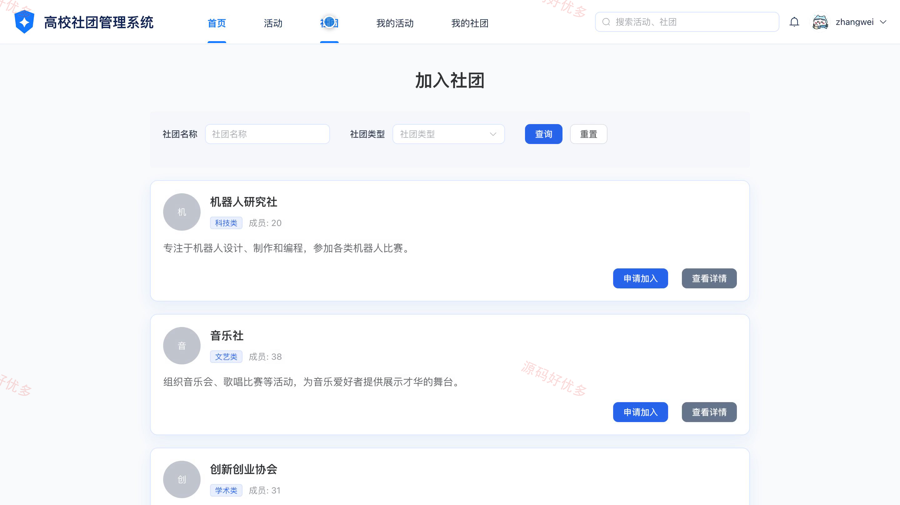
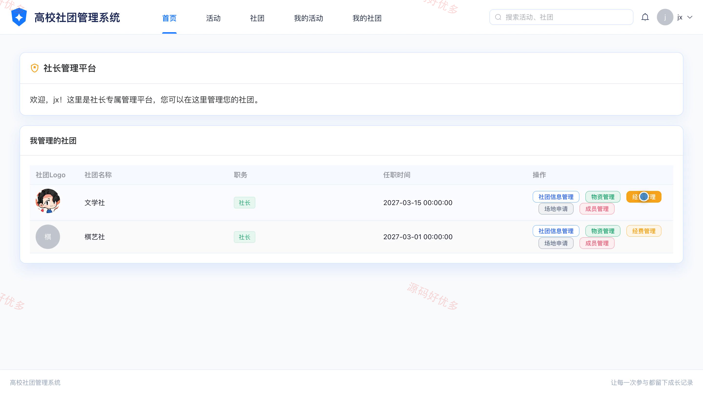
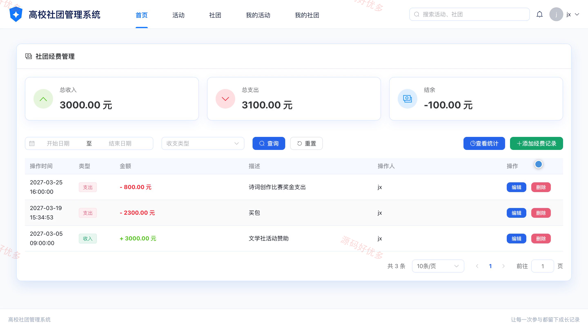
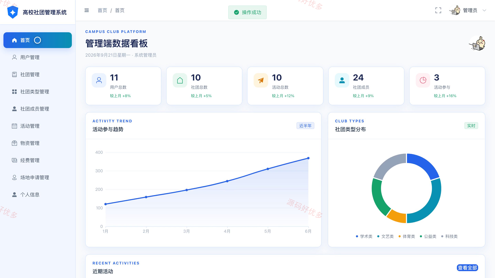
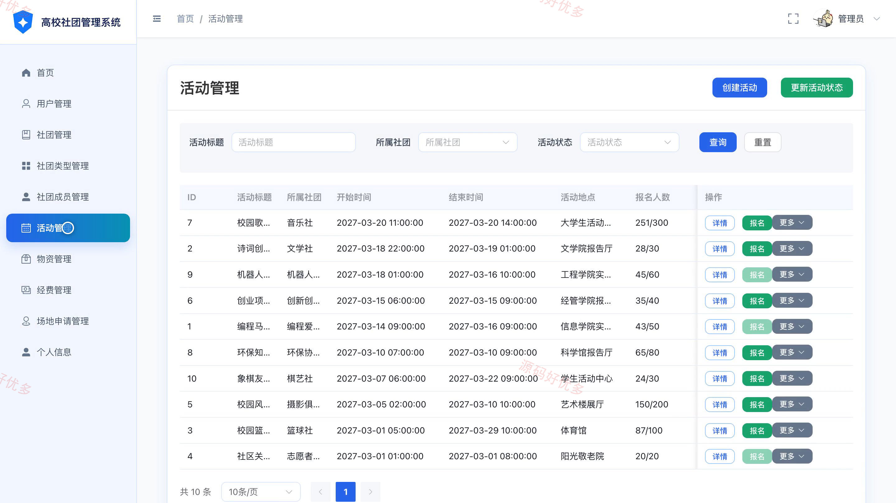
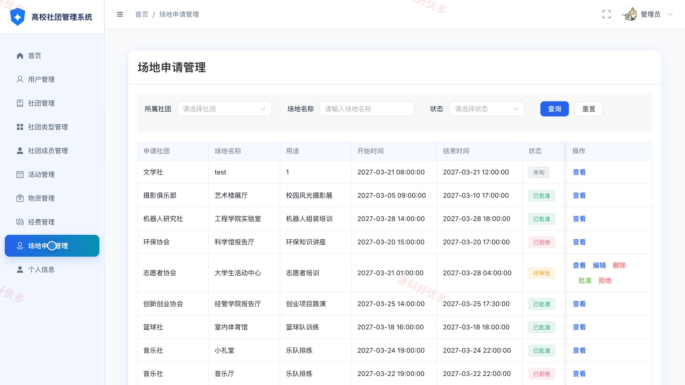

# bs003C
bs003C基于Django的高校社团管理系统源码 Python Django Vue3 前后分离
## 源码问题查看主页咨询

### 一、关键词
高校社团管理、学生社团、校园活动报名、社团招新、活动场地申请

### 二、作品包含
源码+数据库+万字设计文档+PPT+全套环境和工具资源+本地部署教程

### 三、项目技术
前端技术： Html、Css、Js、Vue3.2、Element-Plus
后端技术：Python、Django

### 四、运行环境要求
开发工具：PyCharm + VSCODE

数据库：MySQL5.7+（共11张表）

数据库管理工具：Navicat10以上版本

环境配置软件： Python3+

前端Nodejs：16+

浏览器：谷歌浏览器

### 五、项目介绍
项目编号：bs003C

本系统面向用户、社长或副社长及系统管理员，围绕高校社团和校园活动，提供社团浏览与加入、活动报名、成员审核、物资与经费管理、场地申请等功能。

角色：用户、社长或副社长、管理员

用户功能：浏览与检索社团活动、查看社团详情并申请加入、查看我的社团及成员状态、查看活动详情并报名或取消报名、查看我的活动与报名状态、维护个人资料与修改密码。

社长或副社长功能：维护所属社团信息、审核成员加入申请、管理社团成员及角色、管理社团物资、管理社团经费并查看统计、提交与管理场地申请。

管理员功能：查看系统概览与统计图表、管理用户和社团及社团类型、管理社团成员与加入申请、管理活动与报名记录、管理物资与经费记录、审批场地申请、维护个人资料。

### 六、运行截图

